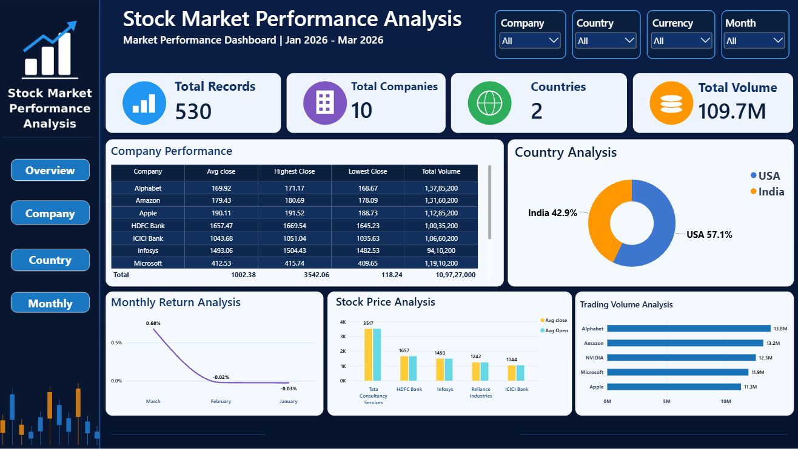

# Global Stock Market Analysis

## Table of Contents
- [Overview](#overview)
- [Problem Statement](#problem-statement)
- [Dataset](#dataset)
- [Tools and Technologies](#tools-and-technologies)
- [Methods](#methods)
- [Key Insights](#key-insights)
- [Dashboard / Model / Output](#dashboard--model--output)
- [Repository Structure](#repository-structure)
- [How to Run This Project?](#how-to-run-this-project)
- [Results & Conclusion](#results--conclusion)
- [Author](#author)

---

An end-to-end analysis of 5 Indian and 5 US stocks using Python, SQL Server and Power BI to compare stock performance, identify top-performing companies and analyse trading volume across both markets.

## Overview

This project compares the stock performance of 10 companies, including 5 from India and 5 from the USA. It uses daily stock prices (Open, High, Low and Close) and trading volume over approximately three months, from 5 January 2026 to 27 March 2026.

The project follows a complete data analysis workflow, starting with raw stock market data and ending with an interactive Power BI dashboard.

1. Raw data was inspected and cleaned using Python and Pandas.
2. Daily returns and total returns were calculated for each stock.
3. Stock performance, trading volume, country-wise returns and monthly price trends were analysed.
4. Cleaned data was stored and validated in SQL Server.
5. An interactive 4-page Power BI dashboard was created using DAX measures, KPI cards and slicers.

**Data handling decision:** Missing Volume values were kept as NULL instead of being replaced with zero, mean or median values to avoid introducing inaccurate trading volume figures.

## Problem Statement

Investors often need to understand how different stocks perform and how markets compare.

This project focuses on answering three main questions:

- Which stocks performed best during the selected period?
- How did Indian stocks perform compared to US stocks?
- Which companies recorded the highest and lowest trading volumes?

### Companies Covered

| Market | Companies |
|---|---|
| India (INR) | Reliance Industries, Tata Consultancy Services, Infosys, HDFC Bank, ICICI Bank |
| USA (USD) | Apple, Microsoft, NVIDIA, Alphabet, Amazon |

## Dataset

**Raw Dataset:** `StockMarketing.csv`

The dataset contains 600 rows representing 10 companies across 60 trading days.

| Column | Description |
|---|---|
| Date | Trading date |
| Company | Company name |
| Ticker | Stock symbol |
| Country | India / USA |
| Currency | INR / USD |
| Open | Opening stock price |
| High | Highest stock price |
| Low | Lowest stock price |
| Close | Closing stock price |
| Volume | Number of shares traded |

**Cleaned Dataset:** `Stock_Clean.csv`

- Contains 530 rows after removing records with missing price values.
- Includes two additional columns: `Daily_Return` and `Month`.
- Missing Volume values were retained as NULL.

## Tools and Technologies

| Tool | Purpose |
|---|---|
| Python | Data analysis |
| Pandas | Data inspection, cleaning and return calculations |
| Matplotlib | Creating line and bar charts |
| SQL Server | Storing cleaned data, validation and analytical queries |
| Power BI | Building an interactive 4-page dashboard |
| DAX | Creating measures and KPIs |

## Methods

### Workflow

```text
StockMarketing.csv
        |
        v
Python (Pandas + Matplotlib)
        |
        v
Stock_Clean.csv
        |
        v
SQL Server
        |
        v
Power BI Dashboard
(DAX, KPIs and Slicers)
```

### 1. Data Cleaning (Python and Pandas)

| Step | Action | Outcome |
|---|---|---|
| 1 | Checked dataset shape, data types and duplicates | No duplicates found |
| 2 | Converted Date to datetime and sorted by Company and Date | Data prepared for time-series analysis |
| 3 | Removed rows with missing Open, High, Low or Close values | 600 → 530 rows |
| 4 | Validated OHLC price logic | No invalid rows |
| 5 | Calculated daily returns for each company | `Daily_Return` column added |

**Why were missing Volume values kept as NULL?**

There were 30 rows with missing Volume values. These were deliberately left as NULL because replacing them with zero, mean or median could introduce inaccurate trading volume figures and affect the analysis.

Since price analysis does not depend on Volume, retaining NULL values was the more appropriate approach.

### 2. Return Calculation

Two types of returns were calculated:

**Daily Return (%)**

\[
\frac{Close_{today}-Close_{yesterday}}{Close_{yesterday}}\times100
\]

**Total Return (%)**

\[
\frac{Final\ Close-Initial\ Close}{Initial\ Close}\times100
\]

- Used Pandas `groupby` to calculate returns separately for each company.
- Total return was calculated using the first and last available closing prices of each company in the cleaned dataset.

### 3. Stock Market Analysis

The following analysis was performed:

- Average daily return of all 10 companies.
- Total return comparison across companies.
- Average daily return comparison between India and USA.
- Total trading volume of each company.
- Monthly average closing price comparison for January, February and March 2026.

**Currency consideration:** INR and USD stock prices were analysed separately to avoid directly comparing values in different currencies.

### 4. SQL Server Validation

- Loaded the cleaned dataset into SQL Server.
- Stored the data in a table named `Stock_Clean`.
- Validated the stored data.
- Ran analytical SQL queries to compare stock performance and trading volume.

### 5. Power BI Dashboard

- Connected Power BI to the `Stock_Clean` table in SQL Server.
- Created DAX measures and KPIs.
- Added interactive slicers for filtering the analysis.
- Developed a 4-page dashboard to explore stock performance and market comparisons.

## Key Insights

| Analysis | Result |
|---|---|
| Highest Total Return | Alphabet (+1.02%) |
| Lowest Total Return | Amazon (−1.19%) |
| Highest Total Trading Volume | Alphabet |
| Lowest Total Trading Volume | Reliance Industries |

**India vs USA Average Daily Return**

- India: XX%
- USA: XX%

*Replace XX% with the actual results from your analysis before publishing.*

Monthly average closing prices were also compared across January, February and March 2026.

## Dashboard / Model / Output

| Output | File |
|---|---|
| Raw Dataset | `StockMarketing.csv` |
| Cleaned Dataset | `Stock_Clean.csv` |
| Python Analysis | `stock_markting_analysis.ipynb` |
| Power BI Dashboard | `Stoct_Market_Dashboard.pbix` |

The interactive Power BI dashboard contains 4 pages with KPI cards, DAX measures and slicers to explore stock performance, trading volume and market comparisons.

### Dashboard Preview

 

## Repository Structure

```text
Global-Stock-Market-Analysis/
│
├── README.md
├── StockMarketing.csv
├── Stock_Clean.csv
├── stock_markting_analysis.ipynb
├── Stoct_Market_Dashboard.pbix
│
└── Images/
    └── dashboard.png
```

## How to Run This Project?

### Step 1: Clone the Repository

```bash
git clone YOUR_GITHUB_REPOSITORY_LINK
```

### Step 2: Install Required Libraries

```bash
pip install pandas matplotlib jupyter
```

### Step 3: Run Python Analysis

- Open `stock_markting_analysis.ipynb` in Jupyter Notebook.
- Run all notebook cells.
- The notebook performs data cleaning, analysis and return calculations.
- The cleaned dataset is saved as `Stock_Clean.csv`.

### Step 4: Import Data into SQL Server

- Import `Stock_Clean.csv` into SQL Server.
- Create or use a table named `Stock_Clean`.
- Run the analytical SQL queries.

### Step 5: Open Power BI Dashboard

- Open `Stoct_Market_Dashboard.pbix` in Power BI Desktop.
- Connect the dashboard to your SQL Server database.
- Update the data source if required.
- Refresh the data to explore the dashboard.

## Results & Conclusion

- Analysed 600 raw stock market records covering 10 companies.
- Cleaned the dataset and retained 530 valid price records.
- Handled missing Volume values without introducing estimated figures.
- Validated OHLC price data before performing analysis.
- Calculated daily and total returns for each company.
- Compared Indian and US stock market performance.
- Used SQL Server to store and validate cleaned data.
- Built an interactive 4-page Power BI dashboard.

This project helped me gain practical experience in data cleaning, stock market analysis, return calculations, SQL Server and Power BI dashboard development.

## Author

**Md Seraj Anwar**

**Skills:** Python | Pandas | Matplotlib | SQL Server | Power BI | DAX

LinkedIn: https://www.linkedin.com/in/md-seraj-anwar-45a32325a/
